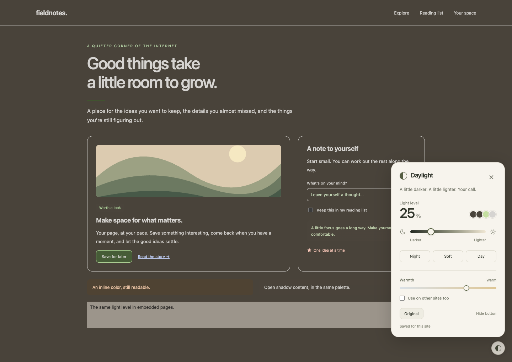

# Daylight

A small slider for making websites lighter or darker. Pick a level that feels right. The page’s backgrounds, text, borders, links and small icons adjust together, while photos and videos keep their colors.



## Bookmark button

[Open the Daylight setup page](https://amkan2024.github.io/daylight/) and drag **Daylight** to your bookmarks bar. Click that bookmark on a website to open the slider.

This version works without Developer mode. Click it again on each new page. It saves settings on the current site in this browser and adjusts the main page. Some protected pages and sites with strict script rules won’t allow bookmarklets.

You can also download the repository and open `bookmarklet/install.html` locally. The copy button gives you the address if dragging isn’t convenient.

## Chrome extension

It’s free. No account, subscription or build step.

1. [Download Daylight](https://github.com/Amkan2024/daylight/releases/latest/download/daylight-1.0.0.zip) and unzip it into a folder you’ll keep.
2. Open `chrome://extensions` in Chrome.
3. Turn on **Developer mode** in the top right.
4. Click **Load unpacked** and choose the unzipped folder containing `manifest.json`.
5. Open a website. Click the little circle in the bottom right and move the slider.

If you downloaded the whole repository instead, choose its `extension` folder. Leave the installed folder where it is; Chrome loads the files from there. Pin Daylight in Chrome’s extensions menu for a second way to reach the controls.

## Use it

- **Light level** goes from Night to Day, with every shade in between.
- **Warmth** takes the edge off cooler colors.
- **Original** restores the page. Click it again to bring your palette back.
- Your choice is saved for each site. **Use on other sites too** makes it the default elsewhere; sites you’ve already adjusted keep their own settings.
- **Hide button** clears the floating circle. Bring it back from the toolbar popup or press **Alt + Shift + D**.

## What to expect

Daylight maps colors in OKLCH, keeps accent hues where possible, and adjusts text contrast as the background changes. Text switches between light and dark around the middle so it stays readable. Dynamic content, forms, open shadow roots and ordinary embedded pages are supported.

Chrome blocks extensions on its settings pages, the Web Store and its built-in PDF viewer. Text inside images, canvas drawings and closed shadow roots can’t be recolored this way. Complex gradients or text over photos may need a different slider setting. Use Original if a page looks off.

Everything runs locally. There are no analytics, remote scripts or network requests. Daylight stores only site settings in Chrome’s local extension storage. Its website access lets it read page styling and apply the palette.

## Update

Replace the files in your installed folder with a newer release, then click Daylight’s reload button at `chrome://extensions` and refresh your open websites.

## Work on it

Both versions ship without runtime dependencies. The extension is plain JavaScript; the bookmark button is built from the same code.

```sh
npm ci
npx playwright install chromium
npm test
npm run package
```

The tests cover palette contrast across the full slider, light and dark source pages, changing content, restoration, embedded pages, open shadow roots, saved settings and both versions’ controls. The packaged extension lands in `dist`; the bookmark installer lands in `bookmarklet` and `docs`.

MIT licensed. Use it, change it, make it better.
